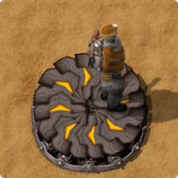

  

  Based in the Philippines

  

  

  **Open to internships, freelance work, and collaborations.**

  ---

  **Building high-performance systems — from autonomous AI daemons and multi-tenant platforms to IoT trackers and Minecraft mods.**

### Research Completed

  

* **Frontend & Web:** `TypeScript` `Next.js 15` `React 19` `SvelteKit` `Tailwind CSS`
* **Mobile:** `Kotlin` `Jetpack Compose` `Android SDK`
* **Backend & Infra:** `Python (FastAPI)` `Supabase` `PostgreSQL` `Docker` `Drizzle` `Prisma`
* **Game Dev & Modding:** `Godot Engine (GDScript)` `Java (Fabric)`
* **Systems & Automation:** `WebSockets` `IoT Telemetry` `Linux Daemons`

### Under Construction

  

* **Karsayo:** A modern multi-tenant car rental platform for SMEs featuring branded operator subdomains, a 6-hour inventory hold engine, valid ID verification, and atomic booking RPCs.

### Production Output

  
  

  
  

* **[SleepIN_PC](https://github.com/Aguynamedkent7/SleepIN_PC):** Linux desktop companion to SleepIN for automated class attendance.
* **Veent WiFi Captive Portal:** A SvelteKit monorepo powering captive customer portals, staff radius administration, and interactive AP coverage maps backed by PostgreSQL & Drizzle.
* **Deezcord & Minecraft Ecosystem:** Real-time Discord-style messaging web app paired with server infrastructure and custom Fabric mods (cards above).

  

 

  
  

   
  <a href="https://aguynamedkent7.github.io">Portfolio</a> •
  <a href="mailto:butaya.kentvincent07@gmail.com">Email Me</a> •
  <a href="https://www.linkedin.com/in/butaya-kent-vincent-b-032959355">LinkedIn</a>
    
  
    
  

